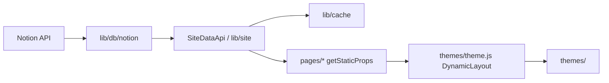

# Repository Guidelines

NotionNext is a **Next.js + Notion API** site system: content (posts, categories, tags,
menus, pages) lives in Notion, and this repo renders it as a blog / portfolio / docs site /
landing page. Package name `notion-next`, version in `package.json`.

> Code comments, docs, and most user-facing strings are **Chinese**. Keep that convention.

## Architecture & Data Flow

Pipeline, top to bottom:

1. **Notion data layer** — `lib/db/notion/*` (+ `lib/db/SiteDataApi.js`).
   `lib/db/notion/getNotionAPI.js` wraps `notion-client`, adds in-flight dedupe and a
   build-time `RateLimiter` (file lock at `.notion-api-lock`).
2. **Site assembly** — `lib/db/SiteDataApi.js` (legacy/primary) produces the shared
   `props` contract: `allPages`, `tagOptions`, `categoryOptions`, `siteInfo`, `posts`,
   `latestPosts`, `NOTION_CONFIG`, `NOTION_TAGS`, … A newer typed slice lives in
   `lib/site/` (`site.api.ts` → `site.service.ts` → `adapters/notion/*` + `processors/*`).
3. **Routing** — `pages/**` runs SSG/ISR in `getStaticProps` / `getStaticPaths`
   (`revalidate` from `NEXT_REVALIDATE_SECOND`), then delegates rendering.
4. **Theming** — `themes/theme.js` exports `DynamicLayout`; it dynamically loads
   `themes/<THEME>/index.js` by layout name and merges `themes/<THEME>/config.js`.
   Every theme consumes the **same props contract**.

**Config priority (high → low):** Notion Config table → environment variables →
`blog.config.js` + `conf/*.config.js`. Always read config via `siteConfig()` from
`lib/config.js`, never `process.env` directly at render time. `NEXT_PUBLIC_*` is the only
client-exposed namespace.

Key rules (from `docs/developer/ARCHITECTURE.md`):

- Global business rules (sorting/filtering/pagination) belong in the **data layer**
  (`lib/db/`, `lib/utils/`), not duplicated across `pages/*`.
- Do **not** copy-paste business logic across route files.

## Key Directories

| Path                            | Purpose                                                                                                         |
| ------------------------------- | --------------------------------------------------------------------------------------------------------------- |
| `pages/`                        | Next.js **Pages Router** routes; SSG/ISR via `getStaticProps/getStaticPaths` (no `app/`)                        |
| `themes/<name>/`                | One theme = one folder: `index.js` (layout), `config.js`, `style.js`, `components/`                             |
| `themes/theme.js`               | Theme registry, `DynamicLayout`, dark-mode init, layout-by-path                                                 |
| `components/`                   | Cross-theme shared components — `components/ui/` plus ~100 flat files; dashboard UI lives in `pages/dashboard/` |
| `lib/db/`                       | Notion fetch/normalize + `SiteDataApi.js` assembly core                                                         |
| `lib/site/`                     | Typed site layer (adapter / normalizer / processor / `site.types.ts`)                                           |
| `lib/cache/`                    | Cache chain: memory / redis / vercel / local-file + `cache_manager.js`, `invalidation.js`                       |
| `lib/build/`                    | `staticPaths.js`, `buildEnv.js`, `prefetch.js` (build-time behavior)                                            |
| `lib/utils/`                    | Pure helpers (`post.js`, `rss.js`, `sitemap.js`, `redirect.js`, …)                                              |
| `lib/plugins/`                  | Optional integrations (algolia, mailchimp, aiSummary, gtag, …)                                                  |
| `lib/server/`                   | Server-only helpers (Notion OAuth, post access, request security, revalidation)                                 |
| `lib/middleware/`               | Edge/middleware helpers (`security.js`)                                                                         |
| `lib/notion/`                   | Notion-specific view helpers (gallery visibility class names)                                                   |
| `lib/config/`                   | Config runtime helpers (env validation)                                                                         |
| `lib/lang/`                     | Theme-agnostic i18n locale strings (`zh-CN.js`, `en-US.js`, …); registry is `lib/utils/lang.js`                 |
| `conf/`                         | Split config modules, aggregated by `blog.config.js` via `...require()`                                         |
| `__tests__/`                    | Jest tests mirrored by source area                                                                              |
| `scripts/`                      | Engineering scripts (see Commands)                                                                              |
| `types/`                        | Global TypeScript types (`types/index.ts`)                                                                      |
| `tools/notionnext-content-mcp/` | MCP server letting AI assistants manage Notion content                                                          |
| `docs/`                         | VitePress source for the public docs site                                                                       |
| `cloudflare/`, `functions/`     | Deployment adapters (Notion image proxy, Netlify functions)                                                     |

## Development Commands

| Command                                                     | Purpose                                                         |
| ----------------------------------------------------------- | --------------------------------------------------------------- |
| `yarn dev`                                                  | Next dev server                                                 |
| `yarn build`                                                | Production build (`BUILD_MODE=true`)                            |
| `yarn start`                                                | Serve production build                                          |
| `yarn export`                                               | Static export + sitemap                                         |
| `yarn lint` / `yarn lint:fix`                               | ESLint                                                          |
| `yarn type-check`                                           | `tsc --noEmit`                                                  |
| `yarn format` / `yarn format:check`                         | Prettier                                                        |
| `yarn quality`                                              | Aggregated quality script (`scripts/quality-check.js`)          |
| `yarn pre-commit`                                           | `lint:fix && format && type-check`                              |
| `yarn test` / `:watch` / `:coverage` / `:ci`                | Jest                                                            |
| `yarn health-check` / `yarn validate`                       | Environment/health check                                        |
| `yarn bundle-report`                                        | Build with `ANALYZE=true`                                       |
| `yarn docs:site:dev` / `:build` / `:preview`                | VitePress docs site                                             |
| `yarn deps:check-lockfile`                                  | `yarn install --frozen-lockfile` + assert `yarn.lock` unchanged |
| `yarn perf:baseline` / `perf:compare` / `perf:audit:themes` | Performance tooling                                             |
| `yarn dev-tools <init\|clean\|docs\|check-updates>`         | Dev helpers (`scripts/dev-tools.js`)                            |
| `yarn translate[:all\|:check\|:backfill]`                   | Notion bilingual translation CLI (`scripts/translate/`)         |

Typical validation before a PR: `yarn lint && yarn type-check && yarn test`.

## Code Conventions & Common Patterns

- **Path alias `@/*` → repo root** (see `tsconfig.json` + `jsconfig.json`). Both
  `@/lib/...` and root-relative `lib/...` styles appear; prefer the alias in new code.
- **Prettier** (`.prettierrc.json`): single quotes, **no semicolons**, no trailing
  commas, `arrowParens: avoid`, `printWidth: 80`, JSX single quotes,
  `jsxBracketSameLine: true`.
- **ESLint** (`.eslintrc.js`): Next + `@typescript-eslint` recommended
  (type-checking rules on). `.js` files are relaxed (many `no-unsafe-*` disabled) because
  most of the codebase is JS; `.ts`/`.tsx` are held to the stricter rules.
- **TypeScript** is `strict` with `noUncheckedIndexedAccess`, `exactOptionalPropertyTypes`,
  and `noImplicitOverride`; `noUnusedLocals`/`noUnusedParameters` are **off**. Code is a
  JS/TS mix (`allowJs: true`) — check surrounding files before assuming types.
- **Naming**: components `PascalCase`; the `/lib/utils` helpers `camelCase`; constants
  `UPPER_SNAKE_CASE`; theme config keys are namespaced per theme (e.g. `SIMPLE_MENU_TAG`).
- **Data-fetch caching**: wrap expensive work with
  `getOrSetDataWithCache(key, fn, ...args)` from `lib/cache/cache_manager.js`
  (`.ts`-free, aliased by `@/lib/...`). Cache keys/generations live in
  `lib/cache/cache_key_path.js` and `invalidation.js`; clear via `clearDataCache()`.
- **Config-driven rendering**: read values with `siteConfig('KEY', defaultValue, props.NOTION_CONFIG)`.
  Never hardcode theme/config values into components.
- **Error handling**: follow the local pattern — catch, `console.error('[scope] ...', e)`,
  and return a safe fallback object (e.g. `EmptyData(pageId)`) so builds/SSG don't crash.
- **Async**: `async/await` throughout with `p-limit` for concurrency control; the Notion
  client dedupes concurrent identical calls.
- **Dark mode / state**: no global store; use `themes/theme.js` helpers
  (`initDarkMode`, `loadDarkModeFromLocalStorage`, …) + React hooks. Local UI state is
  component-local.
- **Client/server boundary**: `'use client'` marks client-only modules (e.g. `lib/config.js`).

## Important Files

| File                               | Role                                                                      |
| ---------------------------------- | ------------------------------------------------------------------------- |
| `blog.config.js`                   | Aggregated config entry (`...require('./conf/*')`) — exports `BLOG`       |
| `lib/config.js`                    | `siteConfig()` resolver + precedence logic; `'use client'`                |
| `lib/db/SiteDataApi.js`            | Core site-data assembly (`fetchGlobalAllData`, `resolvePostProps`)        |
| `lib/db/notion/getNotionAPI.js`    | Notion client wrapper (rate limit + dedupe)                               |
| `lib/cache/cache_manager.js`       | Cache chain + `getOrSetDataWithCache`                                     |
| `themes/theme.js`                  | `DynamicLayout`, `getThemeConfig`, dark-mode init                         |
| `next.config.js`                   | Scans `themes/`, sets webpack aliases, `publicRuntimeConfig`, build hooks |
| `middleware.ts`                    | Clerk auth guards + Notion-UUID→slug redirects                            |
| `types/index.ts`                   | Global shared types                                                       |
| `jest.config.js` / `jest.setup.js` | Test config + global mocks                                                |
| `vercel.json`                      | Vercel overrides (`[skip-version]` ignore command)                        |
| `.env.example`                     | Authoritative env-var reference                                           |

Page entry points: `pages/index.js` (home), `pages/[prefix]/[slug]/[...suffix].js`
(3+ level post routes), `pages/[prefix]/[slug]/index.js` (post detail), plus
`pages/category`, `pages/tag`, `pages/archive`, `pages/search`, `pages/page/[page].js`.

## Runtime/Tooling Preferences

- **Node 22** (`.nvmrc`, `.node-version`; `engines: ">=22 <25"`). Node 20 cannot install deps.
- **Yarn 1.22.22** (`packageManager` field); only `yarn.lock` is committed — never add
  `package-lock.json`, never mix `npm`/`pnpm`. `.yarnrc.yml` is a CI fallback only.
- **Next.js 15.5 (Pages Router)**, React 18, Tailwind 3.4, `react-notion-x` 7.12.1.
- **Deploy targets**: Vercel (primary), Netlify (`@netlify/plugin-nextjs`), Docker
  (`Dockerfile`), Cloudflare (`cloudflare/`). Build env tuning via `lib/build/buildEnv.js`.
- `BUILD_MODE=true` is set by `yarn build`/`yarn export` and enables the Notion rate limiter.
- Commit messages follow **Conventional Commits** (`feat(scope): ...`, `fix: ...`).
- Git hooks via `yarn setup-hooks` (`scripts/setup-git-hooks.js`); pre-commit runs
  lint:fix + format + type-check.

## Testing & QA

- **Framework**: Jest via `next/jest` (`jest.config.js`), `jest-environment-jsdom`,
  `@testing-library/react` + `@testing-library/jest-dom` + `@testing-library/user-event`.
- **Discovery**: `**/__tests__/**/*.{js,jsx,ts,tsx}` and `**/*.(test|spec).{js,jsx,ts,tsx}`;
  `.next/`, `node_modules/`, `out/`, `.vercel/` ignored. Test files mirror their source
  area under `__tests__/` (e.g. `__tests__/lib/cache`, `__tests__/pages`, `__tests__/themes/<theme>`).
- **Global mocks** (`jest.setup.js`): `next/router`, `next/image`, `next/head`,
  `next/dynamic`, `IntersectionObserver`, `ResizeObserver`, `matchMedia`,
  `localStorage`, `sessionStorage`, `fetch`. Reuse these instead of re-mocking.
- **Aliases** in tests: `@/*` plus the same `lodash.throttle` shim as webpack
  (`moduleNameMapper` in `jest.config.js`).
- **Coverage**: `yarn test:coverage` (reporters `text`/`lcov`/`html` into `coverage/`).
  `coverageThreshold` is intentionally empty — reporting only, **CI does not fail on coverage**.
- **CI** (`.github/workflows/ci.yml`): `lint` → `type-check` → `test --passWithNoTests` →
  lockfile consistency → VitePress build. Other workflows cover Docker, docs deploy,
  CodeQL, URL sync, version bump.
- Add tests for behavior/boundaries in `lib/` and `pages/` logic; test _behavior_, not
  wiring or mocked pass-throughs.
